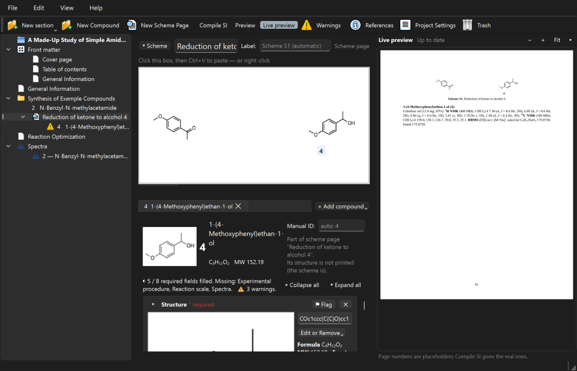

# Chem SI Assistant user guide

Chem SI Assistant helps you build the Supporting Information (SI) of a synthetic
chemistry paper. You enter each compound's data once: structure, procedure, yield, NMR,
HRMS, spectra and so on. The program checks the data, lays it out in the journal's style
and makes the SI as a PDF.

This guide is organised by task. In the program, **Help ▸ User guide** (F1) opens it,
with its headings listed on the left.

**Contents**

- [Installing the program](#installing-the-program)
- [Your first project](#your-first-project)
- [The main window](#the-main-window)
- [Sections and front matter](#sections-and-front-matter)
- [Compounds and their fields](#compounds-and-their-fields)
- [Structures](#structures)
- [Schemes](#schemes)
- [General procedures](#general-procedures)
- [Spectra](#spectra)
- [References and citations](#references-and-citations)
- [Error checks and warnings](#error-checks-and-warnings)
- [Making the PDF: compile and live preview](#making-the-pdf-compile-and-live-preview)
- [Undo](#undo)
- [Updates](#updates)
- [Feedback and problems](#feedback-and-problems)
- [Where your data lives](#where-your-data-lives)

## Installing the program

Download the file for your computer from the
[Releases page](https://github.com/nathanohare/chem-si-assistant/releases). Nothing else
needs installing: Python, the chemistry library (RDKit), the typesetter (Typst) and the
Ketcher drawing editor are all included.

The installers are not signed with a paid certificate yet. Windows and macOS therefore warn
you the first time you open them. This is expected; the steps below get past it.

### Windows

1. Download `Chem-SI-Assistant-<version>-Windows-Setup.exe` and double-click it.
2. If a blue box says **"Windows protected your PC"** (SmartScreen), click **More info**,
   then **Run anyway**.
3. Follow the installer. It installs for you only, so no administrator password is needed.
   It adds a Start-menu entry, and a desktop shortcut if you tick that box.

To remove the program, use **Settings ▸ Apps** (or *Add or remove programs*). Your projects
are not affected, because they live in their own folders.

### macOS

The program runs on Macs with Apple silicon (M1 and newer) and macOS 11 or later. Intel Macs
are not supported yet.

1. Download `Chem-SI-Assistant-<version>-macOS.dmg` and open it.
2. Drag **Chem SI Assistant** onto the **Applications** folder in that window.
3. The first time, **right-click** (or Control-click) the app in Applications, choose
   **Open**, then click **Open** again. After that it opens normally.
4. On newer macOS versions there may be no Open button. In that case, try to open the app
   once, then go to **System Settings ▸ Privacy & Security**. Scroll down to the message
   about Chem SI Assistant and click **Open Anyway**.

### Linux

1. Download `Chem-SI-Assistant-<version>-x86_64.AppImage`. It suits 64-bit PCs with Ubuntu
   22.04 or a similar or newer system.
2. Make it executable: right-click ▸ Properties ▸ Permissions ▸ *Allow executing file as
   program*. Or, in a terminal: `chmod +x Chem-SI-Assistant-*.AppImage`.
3. Double-click it.

## Your first project

1. Start the program and click **New Project…**.
2. Type a **project name**. It becomes the folder's name, and the manuscript title on the
   cover page until you change it.
3. Choose **where** to create the project folder, for example in your OneDrive or Documents
   folder.
4. The first time, the program asks for **your name**. Colleagues see it if you have a
   shared project open. You can change it later in Project Settings ▸ You.

Then work through these steps:

1. Fill in the cover page: **Front matter ▸ Cover page** (title, authors, affiliations).
2. Make a **Data section** for your compounds. Click **New section ▸ New Data section** and
   name it, for example "Synthesis of Products".
3. Set the compound numbers in the section's **ID table** tab, for example *3a, 3b, …* with
   **Fill from pattern…**.
4. Add compounds with **New Compound** (Ctrl+Shift+N) and fill in their fields.
5. Watch the **live preview** on the right. Click **Compile SI** (Ctrl+Shift+B) for the
   whole PDF.

**Open Project…** opens an existing project folder. The start page also lists recent
projects (double-click one to open it). If you tick **Open the last project when the
program starts**, the program skips the start page next time.

## The main window

- **The tree (left)** shows everything in the SI, in print order:
  - the project itself (at the top), which opens the project overview;
  - **Front matter** (cover page, table of contents, General Information);
  - your sections with their compounds and scheme pages;
  - the **Spectra** section.

  Drag items to reorder them. Right-click an item for more actions.
- **The page (middle)** is where you edit the selected item.
- **The live preview (right)** shows that page as it will print. Hide or show it with
  **View ▸ Live preview** (Ctrl+Shift+L).
- **The toolbar** has **New section**, **New Compound**, **New Scheme Page**, **Compile SI**,
  **Preview**, **Live preview**, **Warnings**, **References**, **Project Settings** and
  **Trash**.

The **project overview** shows the whole project at a glance:
- how many compounds are complete;
- which required data is missing;
- warnings and flags by type;
- a table of every compound with each field's state.

Click any cell to open that compound at that field.

**Interface too small or too large?** Choose a size in **View ▸ Interface size** (75–200 %).
The program offers to restart and reopens the same page.

**Useful shortcuts:**

| Shortcut | Action |
|---|---|
| Ctrl+N / Ctrl+O | New / open project |
| Ctrl+Shift+N | New compound |
| Ctrl+Shift+B | Compile SI |
| Ctrl+Shift+P | Preview |
| Ctrl+Shift+L | Live preview |
| Ctrl+Shift+W | Warnings |
| Ctrl+Shift+R | References |
| Ctrl+, | Project Settings |
| F2, Del, Ctrl+↑/↓ | Rename, delete, move (in the tree) |
| Ctrl+Z / Ctrl+Y | Undo / redo |
| F1 | This guide |

## Sections and front matter

### Kinds of section

**New section** (toolbar, or the Edit menu) offers three kinds:

| Kind | For |
|---|---|
| **Custom section** | Your own text, figures and tables, for example "Optimization of the reaction conditions" or "Mechanistic studies". It can have sub-sections, up to three levels (1, 1.1, 1.1.1). |
| **Data section** | Compound pages and scheme pages, with their own compound numbering, general procedures and default fields. |
| **Attachment section** | One PDF or picture made elsewhere, for example an X-ray report. Use **Choose file…**, drop a file onto it, or paste. You can give it a heading and a caption. |

The **Spectra** section is made by the program. It prints every compound's spectra (see
[Spectra](#spectra)). You can move it, but not delete it. To leave the spectra out of a
PDF, untick the section in the Compile SI window.

To make a **sub-section**, select a custom section, then choose **Edit ▸ New sub-section**.
To move a section, drag it in the tree or use **Move Up / Move Down** (Ctrl+↑/↓). You can
also right-click it and choose **Move into section** or **Move out to the top level**.
Deleted items go to the project's Trash, from which you can restore them.

### Front matter

- **Cover page:**
  - heading (empty = the journal's usual heading) and manuscript title;
  - authors, with affiliation markers (e.g. `a,b`), a tick for the corresponding author,
    and email;
  - affiliations;
  - optional extra text.
- **Table of contents:** its title and how much it lists (from "Sections only" to "every
  compound"). Optionally, lists of figures, tables and schemes, dot leaders and the font
  size.
- **General Information:** the usual opening text (materials, instruments, abbreviations…).
  It can hold figures, tables, mentions and citations.

If you already wrote General Information as a custom section, right-click the section and
choose **Use as General Information…**.

### Writing text

Text boxes have a small toolbar:
- the paragraph style (normal text, Heading 1, Heading 2);
- **B** (bold, Ctrl+B), *I* (italic, Ctrl+I), superscript (Ctrl+Shift+=), subscript
  (Ctrl+=);
- alignment;
- **αβγ…** for symbols;
- **H₂**, which subscripts chemical formulas as you type (on by default);
- **@ Mention** (or type `@`), which refers to a compound, scheme, figure or table. The
  number updates itself if things are renumbered.
- **Cite** (see [References and citations](#references-and-citations)).

In custom sections and General Information there are also **Figure…** and **Table…**.
You can also simply paste a picture, a ChemDraw drawing or a table copied from Word or
Excel. Type the caption on the line under it. Right-click a figure or table to change it
(edit table, label, printed size, replace picture…).

You don't have to format chemistry by hand. "1H NMR", "CDCl3" and "J = 7.2 Hz" are fine as
typed; the compiled SI formats them (¹H NMR, CDCl₃, *J*). A blue underline marks formatting
the program can fix for you (see [Error checks and warnings](#error-checks-and-warnings)).

## Compounds and their fields

Select a Data section (or a compound in it) and click **New Compound** (Ctrl+Shift+N).

### Compound numbers (IDs)

A compound's number comes from its Data section's **ID table**: the first compound gets the
first row, the second the second row, and so on. Reorder compounds in the tree and they
are renumbered, and every mention of them in your text follows.

- Edit the table in the Data section's **ID table** tab. **Fill from pattern…** makes rows
  such as *3a, 3b, 3c* (prefix + letters) or *5, 6, 7* (numbers). Double-click a cell to
  change it.
- To fix one compound's number, type it in **Manual ID** on the compound page. It is then
  shown with a 🔒.
- A compound with no row in the table shows **ID?** and a warning.

### Fields

The compound page lists its fields:
- Structure, Name, Experimental procedure, Reaction scale, Yield, Physical state;
- NMR peak reports, HRMS, Spectra, Additional files;
- **Notes**, which are private and never printed.

The header shows how many required fields are filled and which are missing.

- **+ Add field** adds more: melting point, Rf, IR, optical rotation, ee/er, d.r., elemental
  analysis, X-ray (CCDC number), references for a known compound, and others. **Custom
  field…** makes your own.
- **✕** removes a field from this compound. Its data is kept and comes back if you add the
  field again.
- **⚑ Flag** marks a field that needs attention, with a comment (e.g. "re-run ¹³C, poor
  S/N"). Flags appear in the Warnings panel and on the overview.
- **▾ / ▸** fold a field to a one-line summary. **Collapse all / Expand all** do every
  field at once.
- **NMR peak reports:** **+ Add report** adds a report by nucleus. Paste Mnova's peak list
  text straight in. Give a report a label such as "major rotamer" if a compound needs
  several. A ¹⁹F report is added automatically when the structure contains fluorine.

Which fields a new compound gets, in which order, and which are required, is set per Data
section in its **Default fields** tab. **Apply to existing compounds…** updates the
compounds you already have.

### Everything automatic can be changed

The program fills in what it can, and you can always replace it. You can:
- set a manual ID;
- set the HRMS formula (✎) or the part of a salt that is "M";
- type any adduct;
- type your own spectrum headers and captions, and figure, table and scheme labels;
- drag scheme labels;
- use your own picture instead of the program's drawing.

For full control of a compound's printed text, add the field **SI text (replaces the
generated text)**. **Fill with generated text** gives you a starting point.

## Structures

There are several ways to enter a structure in the **Structure** field:

- **From ChemDraw (the usual way):** select the structure in ChemDraw and press Ctrl+C.
  Then click the Structure box in Chem SI Assistant (it gets a blue outline: "Ctrl+V pastes
  here") and press **Ctrl+V**.
- **SMILES:** type or paste SMILES into the box beside the drawing and press Enter.
- **Draw it:** **Draw…** opens the **Ketcher** editor. Draw the structure and click **Use
  this structure**.
- **A file:** **Open MOL/SDF file…**, or drop a .mol/.sdf file onto the box.

The program then shows the **formula, molecular weight and exact mass**, and the HRMS
field calculates the **calcd** m/z for the chosen ion (e.g. [M+H]⁺, [M+Na]⁺).

The SI uses either **ChemDraw's own picture** (pasted with the structure) or the program's
ACS-style drawing. You choose which when you compile.

Once a structure is entered, its buttons fold into **Edit or Remove** (also on right-click).
From there you can:
- edit it in Ketcher;
- replace it with a newly copied one;
- use your own picture;
- copy its SMILES;
- clear it.

## Schemes

A **scheme page** shows a reaction scheme and the compounds made in it.

1. Click **New Scheme Page**, or **Change to reaction scheme…** on a compound.
2. In ChemDraw, select the whole scheme and press Ctrl+C. Click the scheme box and press
   **Ctrl+V**.
3. The compounds' numbers are placed under the matching structures automatically. Drag
   any label to adjust it; **Auto-place labels** places them again.
4. Each compound of the scheme has a tab. **+ Add compound** adds one, blank or taken from a
   structure in the pasted scheme.

The scheme prints as "Scheme S1. *name*" (the label can be changed). Its compounds don't
print their own structure.

## General procedures

You write a general procedure (GP) once and refer to it from each compound.

1. Open the Data section's **General procedures** tab and click **Add**.
2. Give it a name (e.g. "General Procedure A") and an optional title, and write the
   procedure text. It is printed once, at the start of that section.
3. The **compound sentence** is what each compound prints. The default is "Prepared
   according to {GP} from {starting material} ({scale})."
4. On a compound, choose the GP under **General procedure:** in the Experimental procedure
   field. {GP}, {scale}, {yield} and {product} fill themselves in. Other {words} get a box
   each (mentions with `@` work there).
5. Add any further text, such as the purification, in the box below.

## Spectra

### Adding spectra to a compound

The **Spectra** field takes:
- PDF files or pictures: use **Add files…** or drop them onto the field;
- spectra copied in **Mnova**: copy the spectrum in Mnova, click the field and press
  **Ctrl+V** (or **Paste spectrum**).

When you paste, a small window asks what kind of spectrum it is (¹H NMR, ¹³C NMR, …). Its
best guess is in bold, so Enter accepts it.

**How Mnova's copy is kept:**
- **On Windows,** Mnova copies a *metafile*. The program turns it into a sharp vector
  drawing (SVG) and checks the result against Windows' own drawing of it. If the two
  don't match closely enough, or if Mnova copied only a bitmap, the spectrum is kept as
  a high-resolution picture instead. A line under the spectrum says which.
- **For the sharpest result,** choose **"Enhanced Windows Metafile"** in Mnova's copy
  options, then copy again.
- **On macOS,** Mnova copies a PDF, which is kept as it is.
- **Mnova's original copy is always kept** next to the stored spectrum. **Project Settings
  ▸ Output ▸ Re-render pasted pictures…** can convert it again later (metafiles only on
  Windows).

Each spectrum can have its own header and caption ("empty = automatic").

### The Spectra section

The Spectra section prints every compound's spectra, compound by compound. Its page sets
the defaults for all spectra:
- spectra per page and orientation;
- a header line and a frame;
- **auto-crop** of white margins;
- the structure and compound number drawn on each spectrum (position, size, frame…);
- **links**: each NMR report in the compound data can link to its spectrum in the PDF, and
  back.

Under the section in the tree, each compound with spectra has its own page. There you can:
- change the order;
- drag and resize the structure box;
- change one spectrum's settings.

## References and citations

- **References** (toolbar, or Ctrl+Shift+R) opens the project's reference list. Add
  references:
  - **by DOI** (filled in from Crossref; needs the internet);
  - **by hand**;
  - by **importing a BibTeX or RIS file** from your reference manager.
- To cite in a text, click **Cite** in the text box's toolbar and pick one or more
  references (Ctrl+click for several).
- For a **known compound**, add the field **References (known compound)**. It prints a
  sentence such as "Spectral data matched those reported in the literature." with your
  citations.

Only cited references are printed. They are numbered in order of first citation, in the
journal's style.

## Error checks and warnings

The program checks your data as you type. Warnings **never block you**: they point out
things worth a second look. The checks:

| Check | What it compares |
|---|---|
| ¹H integration | Integrations against the structure's hydrogens |
| ¹³C signal count | Signals against the structure's symmetry-distinct carbons |
| Solvent or impurity peaks | Signals at known solvent and impurity shifts (the table is editable in Project Settings ▸ NMR impurities) |
| HRMS | Found m/z against the calculated value (tolerance in Project Settings ▸ Output) |
| Other | Large *J* values; yield against mass; spectra against NMR reports; NMR frequencies; missing heteroatom NMR; compound IDs; general procedures; deleted mentions; missing references; duplicate labels; missing figure or table files |

Each check is approximate. Rotamers, C–F coupling and overlapping signals can make counts
differ, so judge for yourself.

- A warning shows under its field and in the **Warnings** panel (toolbar, Ctrl+Shift+W).
  Double-click a line to go there.
- **Dismiss…** hides a warning that doesn't apply. You can add a reason, which is saved
  with the project. If the data changes, the warning comes back. **Show dismissed** and
  **Restore** bring dismissed warnings back.

**Spelling and formatting:**
- **Red underline: spelling.** The program knows English and a large chemistry dictionary.
  Right-click a word for suggestions, or add it to **this project's dictionary** (shared
  with everyone using the project) or to **my dictionary** (all your projects on this
  computer).
- **Blue underline: formatting.** For example, a formula without subscripts, "CDCl3", a
  number without a space before its unit, or a hyphen in a number range (7.36-7.29).
  Right-click it to fix it, to fix every problem in that text at once, or to leave it as
  written.

## Making the PDF: compile and live preview

- The **live preview** (right) updates about a second after you stop typing. It shows the
  page you are editing; page numbers there are placeholders.
- **Preview** (Ctrl+Shift+P) shows the selected compound, scheme or section in a window of
  its own.
- **Compile SI** (Ctrl+Shift+B) makes the whole SI.

In the Compile SI window you choose:
- ChemDraw's pictures or the program's ACS-style drawings;
- whether chemistry text is formatted automatically;
- whether to open the PDF when it's ready;
- which parts to include. Untick a section to leave it out, together with its
  sub-sections and its compounds' spectra.

The PDF is saved as **build/SI.pdf** in the project folder. If that file is open in a PDF
viewer that locks it, the new one gets a numbered name instead.

The **journal style** (ACS, Wiley or RSC) is chosen in **Project Settings ▸ Output**.
Other tabs there set:
- structure drawings (bond length, fonts…);
- page headers and footers;
- figure, table and scheme labels;
- the NMR impurity table;
- your name.

## Undo

**Edit ▸ Undo** (Ctrl+Z) and **Redo** (Ctrl+Y or Ctrl+Shift+Z) work across the whole
project: typing, fields, structures, pastes, adding, deleting and moving items, settings,
references and more. The menu names the step ("Undo Delete compound 3a"). About the last
50 steps are kept until you close the project.

Everything is **saved automatically** as you work; there is no Save button.

## Updates

When it starts, the program asks GitHub whether a newer version exists. It sends nothing
about you or your projects. If there is one, it shows what's new with three choices:
- **Download and install.**
  - On Windows, the program downloads the installer, saves your work, closes the project,
    starts the installer and quits; the installer replaces the old version.
  - On macOS and Linux, the new version is downloaded to your Downloads folder and shown
    to you. Quit the program, then drag the new app into Applications (macOS, replacing the
    old one), or start the new AppImage (Linux; you can delete the old one).
  - If a release has no file for your computer, the download page opens instead.
- **Remind me later** or **Skip this version**.

**Help ▸ Check for updates…** checks at any time. To turn off the check at start-up,
untick **View ▸ Check for updates when the program starts**.

## Feedback and problems

- **Help ▸ Send feedback…** sends a bug report, an idea or other feedback. It opens a
  pre-filled page on GitHub in your browser, with the program version and your operating
  system filled in. A free GitHub account is needed. Nothing from your projects is sent;
  attach a file there yourself if it helps.
- If something goes wrong unexpectedly, a **"Something went wrong"** message appears.
  **Report this problem** opens the same GitHub page with the technical details filled in.
  The details say where in the program the error happened, not what is in your project.
- **Help ▸ About** shows the version and licence.

## Where your data lives

**Everything in a project is kept in its own folder** (the Project Folder), as ordinary,
readable files:
- `project.json`, the settings;
- a folder per section and per compound;
- the spectra and pictures;
- `references.json`.

Nothing is hidden elsewhere, so the folder *is* the project: copy it, back it up or zip it
like any other folder. **File ▸ Show Project Folder** opens it.

- **The compiled SI** is saved in `build/`. That folder can be deleted when the project is
  closed; it is made again.
- **Snapshots:** **File ▸ Save Snapshot…** saves a dated zip copy of the whole project in
  `snapshots/`, with an optional label such as "submitted version". Make one before
  submitting or before big changes. Snapshots are your safety net; the program makes no
  other automatic backups.
- **Trash:** deleted sections, compounds and pictures go to the project's Trash. **File ▸
  Trash…** restores them, or empties the Trash for good.

### Sharing a project (OneDrive, Dropbox, a network drive)

A project can live in a synced or shared folder, so co-authors can work on it, **one
person at a time**:

- While you have a project open, the program keeps a small lock file (`.lock`) in it,
  showing your name and computer.
- If someone else opens it, they see who has it open. They can choose **Open read-only**
  (look, don't change) or **Take over** (only if you have really stopped, e.g. you forgot
  to close it at work). If it is taken over, your window becomes read-only.
- Let the sync finish before a colleague opens the project on another computer. Close the
  project when you are done (**File ▸ Close Project**), so the lock is released.

A project saved by a newer version of the program opens read-only in an older one, after a
warning. Update the program to edit it.
