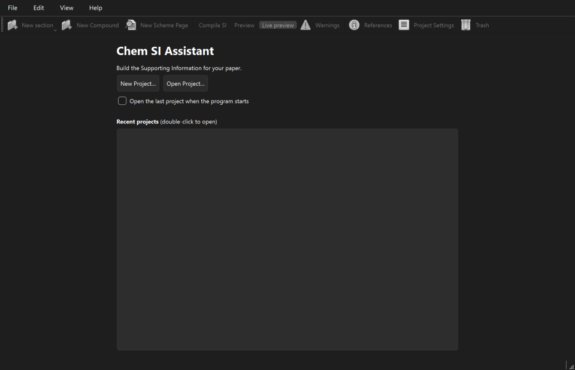
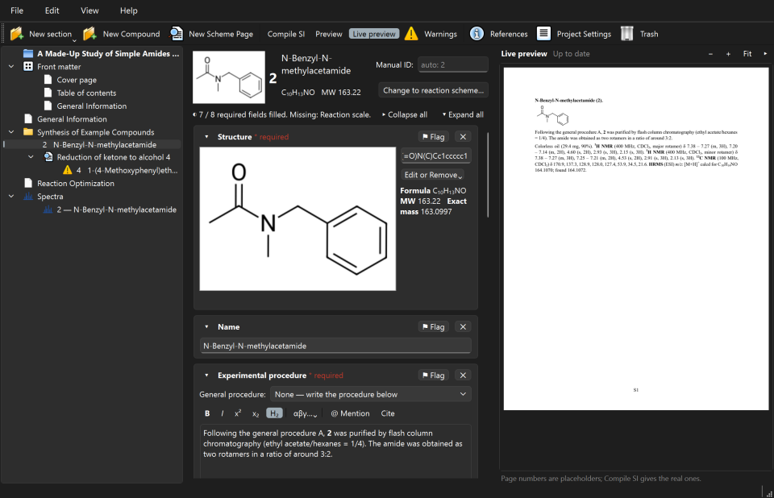
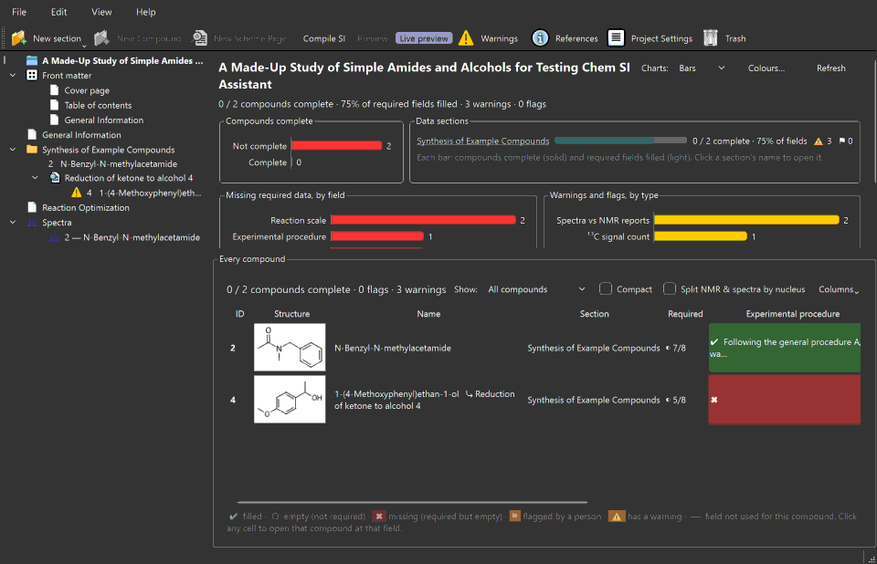
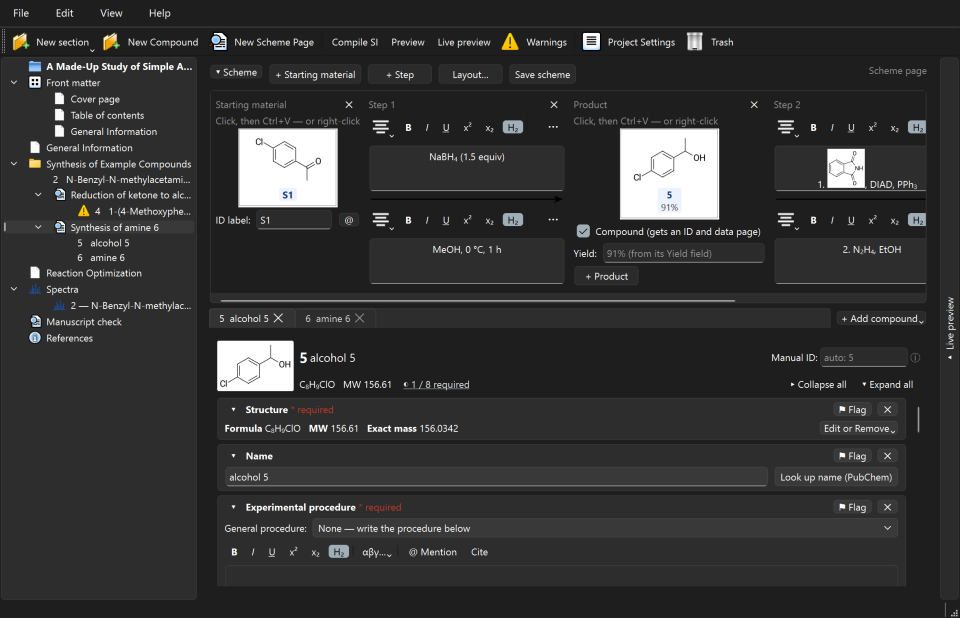
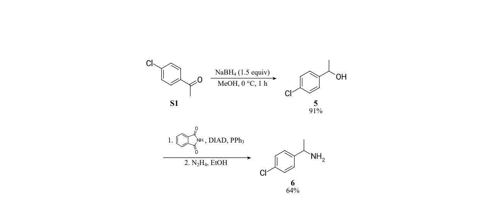
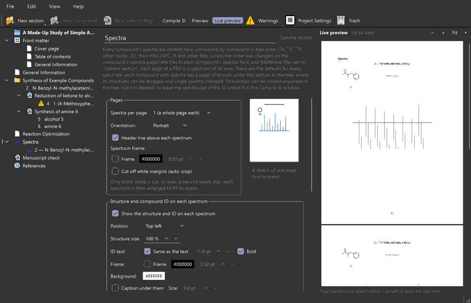
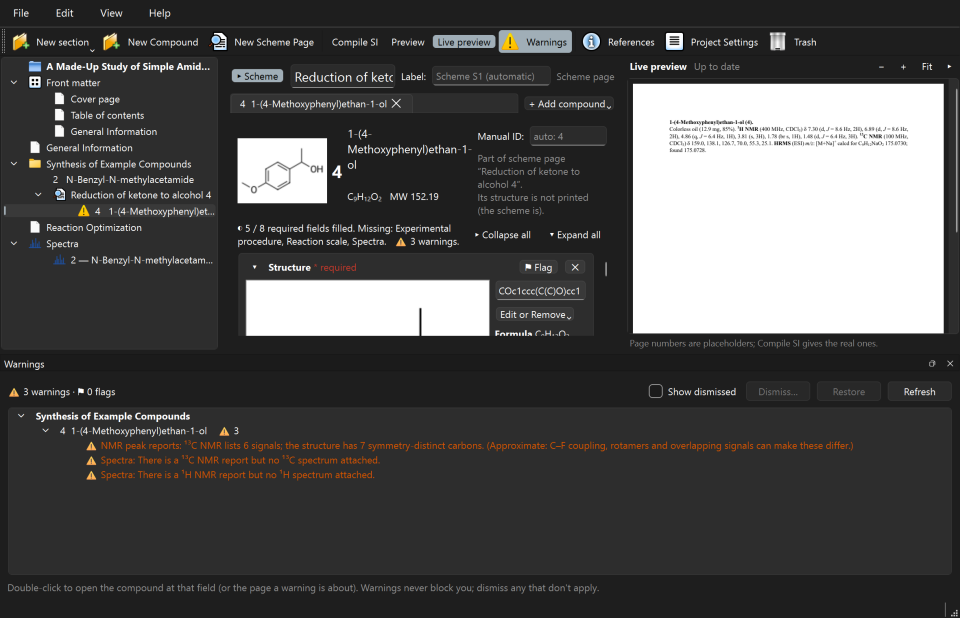
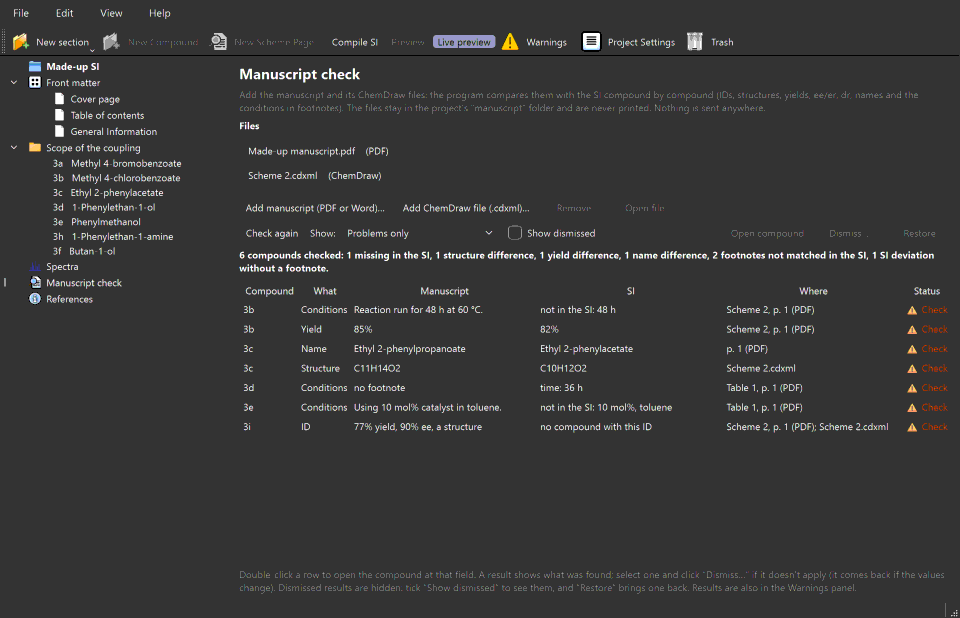
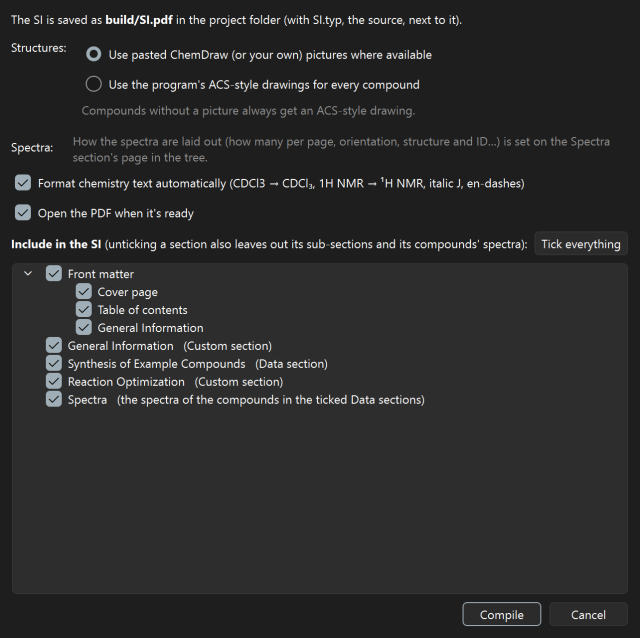

# Chem SI Assistant user guide

Chem SI Assistant helps you build the Supporting Information (SI) of a synthetic
chemistry paper. You enter each compound's data once: structure, procedure, yield, NMR,
HRMS, spectra and so on. The program checks the data, lays it out in the journal's style
and makes the SI as a PDF.

This guide is organised by task. In the program, **Help ▸ User guide** (F1) opens it,
with its headings listed on the left.

**Contents**

- [Installing the program](#installing-the-program)
- [Your first project](#your-first-project)
- [The main window](#the-main-window)
- [Sections and front matter](#sections-and-front-matter)
- [Compounds and their fields](#compounds-and-their-fields)
- [Structures](#structures)
- [Schemes](#schemes)
- [General procedures](#general-procedures)
- [Spectra](#spectra)
- [References and citations](#references-and-citations)
- [Error checks and warnings](#error-checks-and-warnings)
- [Checking the manuscript against the SI](#checking-the-manuscript-against-the-si)
- [Making the PDF: compile and live preview](#making-the-pdf-compile-and-live-preview)
- [Undo](#undo)
- [Updates](#updates)
- [Feedback and problems](#feedback-and-problems)
- [Where your data lives](#where-your-data-lives)

## Installing the program

Download the file for your computer from the
[Releases page](https://github.com/nathanohare/chem-si-assistant/releases). Nothing else
needs installing: Python, the chemistry library (RDKit) and the typesetter (Typst) are
included.

The installers are not signed with a paid certificate yet. Windows and macOS therefore warn
you the first time you open them. This is expected; the steps below get past it.

### Windows

1. Download `Chem-SI-Assistant-<version>-Windows-Setup.exe` and double-click it.
2. If a blue box says **"Windows protected your PC"** (SmartScreen), click **More info**,
   then **Run anyway**.
3. Follow the installer. It installs for you only, so no administrator password is needed.
   It adds a Start-menu entry, and a desktop shortcut if you tick that box.

To remove the program, use **Settings ▸ Apps** (or *Add or remove programs*). Your projects
are not affected, because they live in their own folders.

### macOS

The program runs on Macs with Apple silicon (M1 and newer) and macOS 11 or later. Intel Macs
are not supported yet.

1. Download `Chem-SI-Assistant-<version>-macOS.dmg` and open it.
2. Drag **Chem SI Assistant** onto the **Applications** folder in that window.
3. The first time, **right-click** (or Control-click) the app in Applications, choose
   **Open**, then click **Open** again. After that it opens normally.
4. On newer macOS versions there may be no Open button. In that case, try to open the app
   once, then go to **System Settings ▸ Privacy & Security**. Scroll down to the message
   about Chem SI Assistant and click **Open Anyway**.

### Linux

1. Download `Chem-SI-Assistant-<version>-x86_64.AppImage`. It suits 64-bit PCs with Ubuntu
   22.04 or a similar or newer system.
2. Make it executable: right-click ▸ Properties ▸ Permissions ▸ *Allow executing file as
   program*. Or, in a terminal: `chmod +x Chem-SI-Assistant-*.AppImage`.
3. Double-click it.

## Your first project

**New here? Look at the example first.** The start page has a highlighted box for the
example SI that comes with the program: **Open the Example Project** opens your own copy of
it (change anything you like; the original stays as it was), and **View Its Finished SI
(PDF)** shows the SI compiled from it. Both are also in the **Help** menu. Your copy is kept
in the program's own folder on this computer (on Windows `%LOCALAPPDATA%\Chem SI
Assistant\Example project`), so opening it again shows your changes; **Help ▸ Start the
example over** gives you a fresh copy. When an update brings a new version of the example,
the program asks whether to replace your copy. The
example has six compounds made by one general procedure, a follow-up reaction, two schemes,
an optimisation table, HRMS report files and references. Its data come from published papers
(cited in it); its spectra are simulated from those data and are marked so on every page.

1. Start the program and click **New Project…**.
2. Type a **project name**. It becomes the folder's name, and the manuscript title on the
   cover page until you change it.
3. Choose **where** to create the project folder, for example in your OneDrive or Documents
   folder.
4. The first time, the program asks for **your name**. Colleagues see it if you have a
   shared project open. You can change it later in Project Settings ▸ You.

Then work through these steps:

1. Fill in the cover page: **Front matter ▸ Cover page** (title, authors, affiliations).
2. Make a **Data section** for your compounds. Click **New section ▸ New Data section** and
   name it, for example "Synthesis of Products".
3. Set the compound numbers in the section's **ID table** tab, for example *3a, 3b, …* with
   **Fill from pattern…**.
4. Add compounds with **New Compound** (Ctrl+Shift+N) and fill in their fields.
5. Watch the **live preview** on the right. Click **Compile SI** (Ctrl+Shift+B) for the
   whole PDF.

**Open Project…** opens an existing project folder. The start page also lists recent
projects (double-click one to open it). If you tick **Open the last project when the
program starts**, the program skips the start page next time.

## The main window

- **The tree (left)** shows everything in the SI, in print order:
  - the project itself (at the top), which opens the project overview;
  - **Front matter** (cover page, table of contents, General Information);
  - your sections with their compounds and scheme pages;
  - the **Spectra** section;
  - **References** (the project's reference list), always last.

  Drag items to reorder them. Right-click an item for more actions.
- **The page (middle)** is where you edit the selected item.
- **The live preview (right)** shows that page as it will print. Hide or show it with
  **View ▸ Live preview** (Ctrl+Shift+L).
- **The toolbar** has **New section**, **New Compound**, **New Scheme Page**, **Compile SI**,
  **Preview**, **Live preview**, **Warnings**, **Project Settings** and **Trash**. (The
  reference list is the **References** item at the bottom of the tree.)

The **project overview** shows the whole project at a glance:
- how many compounds are complete;
- which required data is missing;
- warnings and flags by type;
- a table of every compound with each field's state.

Click any cell to open that compound at that field.

**Interface too small or too large?** Choose a size in **View ▸ Interface size** (75–200 %).
The program offers to restart and reopens the same page.

**Useful shortcuts:**

| Shortcut | Action |
|---|---|
| Ctrl+N / Ctrl+O | New / open project |
| Ctrl+Shift+N | New compound |
| Ctrl+Shift+B | Compile SI |
| Ctrl+Shift+P | Preview |
| Ctrl+Shift+L | Live preview |
| Ctrl+Shift+W | Warnings |
| Ctrl+Shift+R | References (the page at the bottom of the tree) |
| Ctrl+, | Project Settings |
| F2, Del, Ctrl+↑/↓ | Rename, delete, move (in the tree) |
| Ctrl+Z / Ctrl+Y | Undo / redo |
| F1 | This guide |

## Sections and front matter

### Kinds of section

**New section** (toolbar, or the Edit menu) offers three kinds:

| Kind | For |
|---|---|
| **Custom section** | Your own text, figures and tables, for example "Optimization of the reaction conditions" or "Mechanistic studies". It can have sub-sections, up to three levels (1, 1.1, 1.1.1). |
| **Data section** | Compound pages and scheme pages, with their own compound numbering, general procedures and default fields. |
| **Attachment section** | One PDF or picture made elsewhere, for example an X-ray report. Use **Choose file…**, drop a file onto it, or paste. You can give it a heading and a caption. |

The **Spectra** section is made by the program. It prints every compound's spectra (see
[Spectra](#spectra)). You can move it, but not delete it. To leave the spectra out of a
PDF, untick the section in the Compile SI window.

To make a **sub-section**, select a custom section, then choose **Edit ▸ New sub-section**.
To move a section, drag it in the tree or use **Move Up / Move Down** (Ctrl+↑/↓). You can
also right-click it and choose **Move into section** or **Move out to the top level**.
Deleted items go to the project's Trash, from which you can restore them.

### Front matter

- **Cover page:**
  - heading (empty = the journal's usual heading) and manuscript title;
  - authors, with affiliation markers (e.g. `a,b`), a tick for the corresponding author,
    and email;
  - affiliations;
  - optional extra text.
- **Table of contents:** its title and how much it lists (from "Sections only" to "every
  compound"). Optionally, lists of figures, tables and schemes, dot leaders and the font
  size.
- **General Information:** the usual opening text (materials, instruments, abbreviations…).
  It can hold figures, tables, mentions and citations.

If you already wrote General Information as a custom section, right-click the section and
choose **Use as General Information…**.

### Writing text

Text boxes have a small toolbar:
- the paragraph style (normal text, Heading 1, Heading 2);
- **B** (bold, Ctrl+B), *I* (italic, Ctrl+I), U (underline, Ctrl+U), superscript
  (Ctrl+Shift+=), subscript (Ctrl+=);
- alignment;
- **αβγ…** for symbols;
- **H₂**, which subscripts chemical formulas as you type (on by default);
- **@ Mention** (or type `@`), which refers to a compound, scheme, figure or table. The
  number updates itself if things are renumbered.
- **Cite** (see [References and citations](#references-and-citations)).

In custom sections and General Information there are also **Figure…** and **Table…**.
You can also simply paste a picture, a ChemDraw drawing or a table copied from Word or
Excel. Type the caption on the line under it. Right-click a figure or table to change it
(edit table, label, printed size, replace picture…).

You don't have to format chemistry by hand. "1H NMR", "CDCl3" and "J = 7.2 Hz" are fine as
typed; the compiled SI formats them (¹H NMR, CDCl₃, *J*). A blue underline marks formatting
the program can fix for you (see [Error checks and warnings](#error-checks-and-warnings)).

## Compounds and their fields

Select a Data section (or a compound in it) and click **New Compound** (Ctrl+Shift+N).

### Compound numbers (IDs)

A compound's number comes from its Data section's **ID table**: the first compound gets the
first row, the second the second row, and so on. Reorder compounds in the tree and they
are renumbered, and every mention of them in your text follows.

- Edit the table in the Data section's **ID table** tab. **Fill from pattern…** makes rows
  such as *3a, 3b, 3c* (prefix + letters) or *5, 6, 7* (numbers). Double-click a cell to
  change it.
- To fix one compound's number, type it in **Manual ID** on the compound page. It is then
  shown with a 🔒.
- A compound with no row in the table shows **ID?** and a warning.
- **Make pages for unused IDs…** (ID table tab) makes a blank compound page, at the end of
  the section, for every ID in the table that no compound has yet. Edit ▸ Undo removes them
  again.

### Duplicating a page

Right-click a compound or a scheme page in the tree and choose **Duplicate…**:
- **Number of copies** (up to 50).
- **Where the copies go:** at the end of the section, where they take the next unused IDs
  and nothing else is renumbered (the window shows which IDs), or right after the original,
  which renumbers the compounds after it.
- **Copy the contents of these fields:** tick what to copy (all are ticked at first). The
  copies have the same fields; unticked ones are empty.
- Spectra, Additional files, NMR peak reports, HRMS report files and stored files are
  **never copied**: they belong to the original compound. Nor are the manual ID and flags.
- A **scheme page** is copied with its drawing (boxes, steps, conditions and layout) and all
  its compounds, each copied with the fields you ticked and drawn in the same place in the
  copied scheme. The copy is named "… (copy)".
- A compound of a scheme page is copied as a compound page of its own.
- One Edit ▸ Undo step removes all the copies.

### Fields

The compound page lists its fields:
- Structure, Name, Experimental procedure, Reaction scale, Yield, Physical state;
- NMR peak reports, HRMS, Spectra, Additional files;
- **Notes**, which are private and never printed.

The header at the top of the page is two lines next to the structure:
- the ID, name, **Manual ID** and **Change to reaction scheme…** (or ⓘ on a scheme's
  compound: hover for whether its structure prints);
- the formula and MW, then **◐ 1 / 8 required**: hover it for the missing fields, click it
  to jump to the first one. **Collapse all / Expand all** are at the end of that line.

- **+ Add field** adds more: melting point, Rf, IR, optical rotation, ee/er, d.r., elemental
  analysis, X-ray (CCDC number), references for a known compound, **Purification**, and
  others. **Custom field…** makes your own.
- **Purification:** method, stationary phase and eluent, each a drop-down you can also type
  in; they learn what you have used before (the eluent also offers your Rf eluents). It is
  printed as a sentence at the **end of the experimental procedure**, e.g. "The crude
  product was purified by flash column chromatography (SiO₂, 10% EtOAc/hexanes)." The
  **Printed as** box shows that sentence in grey; type in it to print your own instead. A
  general procedure whose compound sentence has **{purification}** places it there instead
  (then nothing is added at the end).
- **✕** removes a field from this compound. Its data is kept and comes back if you add the
  field again.
- **⚑ Flag** marks a field that needs attention, with a comment (e.g. "re-run ¹³C, poor
  S/N"). Flags appear in the Warnings panel and on the overview.
- **▾ / ▸** fold a field to a one-line summary. **Collapse all / Expand all** do every
  field at once.
- **Dropdowns and number boxes never change with the mouse wheel**, even after you click
  them: the wheel always scrolls the page. Click a dropdown to choose, or type a number.
- **NMR peak reports:** **+ Add report** adds a report by nucleus. Paste Mnova's peak list
  text straight in. Give a report a label such as "major rotamer" if a compound needs
  several. A ¹⁹F report is added automatically when the structure contains fluorine.

Which fields a new compound gets, in which order, and which are required, is set per Data
section in its **Default fields** tab. **Apply to existing compounds…** updates the
compounds you already have.

### Everything automatic can be changed

The program fills in what it can, and you can always replace it. You can:
- set a manual ID;
- set the HRMS formula (✎) or the part of a salt that is "M";
- type any adduct;
- type the formula an elemental analysis was calculated for (e.g. a solvate);
- type your own spectrum headers and captions, and figure, table and scheme labels;
- drag the IDs on a scheme;
- use your own picture instead of the program's drawing.

For full control of a compound's printed text, add the field **SI text (replaces the
generated text)**. **Fill with generated text** gives you a starting point.

## Structures

There are several ways to enter a structure in the **Structure** field:

- **From ChemDraw (the usual way):** select the structure in ChemDraw and press Ctrl+C.
  Then click the Structure box in Chem SI Assistant (it gets a blue outline: "Ctrl+V pastes
  here") and press **Ctrl+V**.
- **Another drawing program:** copy the structure there (as MOL or SMILES) and paste it
  the same way.
- **SMILES:** type or paste SMILES into the box beside the drawing and press Enter.
- **A file:** **Open MOL/SDF file…**, or drop a .mol/.sdf file onto the box.

The program then shows the **formula, molecular weight and exact mass**, and the HRMS
field calculates the **calcd** m/z for the chosen ion (e.g. [M+H]⁺, [M+Na]⁺).

The SI uses **ChemDraw's own picture** (pasted with the structure) where a compound has one,
and the program's ACS-style drawing for a compound with only a structure (SMILES, MOL). When
you compile you can choose "Program drawings for every compound" instead.

The program has no drawing editor of its own: draw in ChemDraw (or any other editor) and
paste.

A structure with a generic atom (R, X, *) can be used, for example for the general product
of a scheme (R = aryl). It has no formula or mass, so its Structure field shows a warning and
the checks that need a formula (HRMS, elemental analysis, ¹H and ¹³C counts) skip it. For a
polymer or another structure that has no single formula, you can also paste its picture
(**Paste image**) and type the formula in the HRMS field (✎).

### Names: paste from ChemDraw, or look them up in PubChem

Type or paste the name into the **Name** field (in ChemDraw: Structure ▸ Convert Structure
to Name, then copy). For a compound that is already published, **Look up name (PubChem)**
next to the box fills in its IUPAC name from PubChem:

- It only works once the compound has a structure, and only when you click it.
- Only the structure's **InChIKey** (a short code calculated from the structure) is sent
  to PubChem, a public database of the US National Institutes of Health. The first time in
  a session a note says so; tick "Don't show this again" to skip it on this computer. Think
  twice before looking up unpublished compounds.
- The exact structure, with its stereochemistry, is looked up first. If PubChem only has
  it without (or with other) stereochemistry, and only one such compound, that name is
  offered, clearly marked "without stereochemistry": check its R/S or E/Z.
- A salt is looked up as a whole.
- Before replacing a name already in the box, the program asks. The name stays editable;
  a small note under the box says it came from PubChem (with a link to its PubChem page)
  until you change it.
- Not in PubChem: the program says so; paste ChemDraw's name instead. No internet: a
  plain message, nothing changes.

### ChemDraw pictures: sharp at any size, printed at one scale

- **Kept as a vector drawing.** On Windows, ChemDraw copies a drawing as a "metafile". The
  program turns it into a vector drawing (SVG), so it stays sharp at any size and its labels
  stay real text in the PDF. Every conversion is checked against Windows' own drawing of the
  same copy; if they don't match closely, the picture is kept at 1200 dpi instead, as
  before. On a Mac, ChemDraw's PDF copy is kept as it is (also a vector drawing). ChemDraw's
  original copy is always stored next to the picture (`structure_image.emf`), so it can be
  converted again later (**Project settings ▸ Output ▸ Re-render pasted pictures**, which
  also turns older 1200-dpi pictures into vector drawings).
- The same happens when you paste a structure into the scheme editor, a figure into a text,
  or a drawing into an Attachment section.
- **One bond length everywhere.** ChemDraw drawings copied at different zoom levels or from
  documents with different settings would print at different sizes. The program measures
  the typical bond length in each pasted structure and prints it so that bonds are the
  length set in **Project settings ▸ Structures ▸ Bond length** (ACS 1996: 0.508 cm). The
  tick box **Print all pasted structures at the same bond length** (on by default) turns
  this off. Screenshots and other pictures without measurable bonds print at their own size.
  Figures always keep their own size.
- **Your own value.** **Edit or Remove ▸ Printed size of the picture…** shows the measured
  bond length; you can type the picture's bond length yourself, or print that picture at its
  own size.
- **Tip: use one ChemDraw style.** Only the size is adjusted. Line widths and label sizes
  grow or shrink with the picture, so they match from structure to structure only if every
  drawing uses the same ChemDraw document settings. Use one style for all structures, e.g.
  **File ▸ Apply Document Settings from ▸ ACS Document 1996** in ChemDraw.
- On a spectrum page the structure's size (and any size you set by dragging its corner)
  starts from this same scale, so what you see there is what prints.

Once a structure is entered, the Structure field shrinks to **one line**: the formula,
molecular weight and exact mass, and an **Edit or Remove** menu (also on right-click). The
structure itself shows, sharp, at the top of the page beside the compound number. From the
menu you can:
- replace it with a newly copied one;
- use your own picture;
- set the printed size of its picture (see below);
- copy its SMILES;
- clear it (the field opens up again, ready for the next paste);
- show all editing controls (the picture, the SMILES box and every button).

While a compound has no structure yet you can also click the empty picture at the top of
the page and press **Ctrl+V**.

## Schemes

A **scheme page** shows a reaction scheme and the compounds made in it. Click **New Scheme
Page**, or **Change to reaction scheme…** on a compound. The scheme is drawn with the
**scheme editor** (below). Its compounds drawn in the scheme don't print their own
structure again (a compound of the page that is not drawn in the scheme prints its own,
like any compound).

The scheme prints on its own, with no label or caption. To print it as "Scheme S1. *name*"
(numbered, listed in the List of Schemes, and possible to mention in texts), tick **Label
and caption** in its **Layout…** (or in Project settings ▸ Schemes, for every scheme). The
**Name (caption)** and **Label** boxes then appear at the top of the page; while it is off
they are hidden, to leave more room (rename the scheme in the tree: right-click ▸ Rename).

The top row of the page holds **▾ Scheme** (fold the scheme away, for more room for the
compounds) and the editor's buttons.

While you edit one of the scheme's compounds, the live preview shows the whole scheme page,
as it prints.

(Older versions could also make a scheme from one pasted picture of the whole scheme. That
choice is gone: such a scheme page now opens in the scheme editor with its compounds as the
products of one step. Paste the starting materials and conditions and arrange the steps. The
old picture file is left in the scheme's folder.)

### Scheme editor

The scheme is laid out left to right as it will print: **starting materials**, then for
each **step** an arrow with conditions above and under it, followed by its **products**.

1. Copy a structure in ChemDraw (Ctrl+C), click a box and press **Ctrl+V**. ChemDraw's
   picture is used (at the project's bond length, like every structure) and its structure
   is kept. Right-click a box to type SMILES, open a MOL/SDF file, paste a picture only, set
   the printed size of the picture, move the box left or right, or remove it. A new scheme
   page starts with one empty starting material and one step; it has no compounds until you
   tick **Compound** under a product.
2. **+ Starting material** adds another starting material (printed with "+" between them);
   **+ Step** adds an arrow and a product at the end; **+ Product** (under a step's last
   product, below its Yield box) adds another product to that step. ✕ removes a box or a step.
3. Type the conditions above and under each arrow. They have the usual formatting (bold,
   italic, underline, sub- and superscripts, the formula button, symbols, @ mentions and
   citations). To put a structure in the conditions (e.g. a reagent), copy it in ChemDraw
   and paste it into the box **above** the arrow (or use its **Structure** button): it
   prints small, in the text. Right-click it for **Printed size of the picture…** (the same
   choices as for a box). Conditions copied into another scheme take their structures with
   them. The button at the left of each conditions toolbar sets its alignment.
4. Tick **Compound (gets an ID and data page)** under a product to make it a compound of
   the scheme page: it gets the next ID from the section's ID table and its own tab with
   all the data fields. Its structure is then the compound's (pasting into the box changes
   the compound's structure, and the other way round). The IDs follow the boxes, left to
   right, step by step. Unticking (or removing the box) asks whether to delete the data page
   too (it goes to the Trash) or keep it on the scheme page. A kept page (or one added with
   **+ Add compound ▸ Blank compound**) is not drawn in the scheme, so its structure prints
   with its own data; **Show a compound of this page** (right-click a product box) draws it
   in a box again.
5. A starting material (or any box that is not a compound) can have an **ID label**: type
   it (e.g. "S1"), or click **@** to use the ID of a compound elsewhere in the project, which
   follows renumbering. It gets no data page.
6. The IDs are drawn under the structures, as printed. **Drag** one to move it (with the
   yield under it); right-click ▸ **Reset the ID's position** puts it back.
7. **Yields:** a compound's yield comes from its Yield field; type in **Yield:** to print
   something else (e.g. "85% (2 steps)"). Right-click a product for "automatic" or "none".
8. **Save scheme** hides the editing buttons and locks the IDs; **Edit scheme** unlocks it.

The scheme gets the height it needs on the page (and no more), and the compound tabs the
rest. On a small screen drag the divider between them to give the compounds more room; the
scheme scrolls left and right (and up and down when it is made shorter).

**How it prints.** Each arrow is as long as the wider of its two conditions texts plus a
little extra before and after (never shorter than the shortest arrow). Structures are
centred on the arrows, with their IDs under them; with **Line up compound IDs in each
row** (on by default) the IDs of a row are on one line under its lowest structure. When a
scheme is too wide for the page it continues on a new row that starts with the next arrow;
or, if you choose **Shrink to fit one line**, the whole scheme is made smaller. If that
makes the conditions smaller than 6 pt, Compile SI warns you (the Layout window also shows
the size the conditions print at).

**Layout.** Project settings ▸ **Schemes** sets the defaults for every scheme: conditions
text size, the size of structures in the conditions (as a percentage), the alignment of the
text above and under the arrows, the extra arrow length before and after the text, the
shortest arrow, the space between items, what to do when the scheme is too wide, the
scheme's size (scale), where yields are printed (under each product, under that step's
conditions, or not at all), whether the IDs of a row are lined up, and whether the scheme
prints with its label and caption (off by default). Each scheme's **Layout…** button changes
them for that scheme
only. A small example shows the effect.

## General procedures

You write a general procedure (GP) once and refer to it from each compound.

1. Open the Data section's **General procedures** tab and click **Add**.
2. Give it a name (e.g. "General Procedure A") and an optional title, and write the
   procedure text. It is printed once, at the start of that section.
3. The **compound sentence** is what each compound prints. The default is "Prepared
   according to {GP} from {starting material} ({scale})."
4. On a compound, choose the GP under **General procedure:** in the Experimental procedure
   field. {GP}, {scale}, {yield}, {product} and {purification} (from the Purification field,
   e.g. "flash column chromatography (SiO₂, 10% EtOAc/hexanes)") fill themselves in. Other {words} get a box
   each (mentions with `@` work there).
   - **{scale}:** typing a scale such as "0.20 mmol" (or "20 µmol") in its box also fills
     the compound's **Reaction scale** field when that is empty (and follows your later
     changes for as long as the field still holds what was filled in). Once the Reaction
     scale field has a value, that value is printed; if it differs from the {scale} box, a
     warning says so.
5. Add any further text in the box below.

Each general procedure needs its own name. Two with the same name anywhere in the project
(capitals and spaces don't count) are marked ⚠ in the **General procedures** tab and listed
in the Warnings panel.

## HRMS and the instrument's report files

The **HRMS** field calculates the expected m/z for the ion you choose and the ppm error of
the found value. Under it, **Report files from the instrument** keeps the files the mass
spectrometer's software made, stored in the compound's `hrms` folder:

- **Add report files…**, drag files onto the field, or copy them in File Explorer/Finder,
  click the field and press **Ctrl+V** (or **Paste copied files**). Any file is kept,
  including whole raw-data folders (e.g. an Agilent `.d` folder).
- **✕** moves a file to the project Trash (it can be restored, and Edit ▸ Undo works).
- Each file shows what was read from it.

**The found m/z is read from these files** (no vendor software needed):
- PDF reports (the text in them; e.g. from MassHunter, Xcalibur/FreeStyle, MassLynx,
  DataAnalysis or LabSolutions), CSV/TSV/TXT peak lists, Excel `.xlsx` files. Many programs
  save their PDFs with edit restrictions; these are read too, using the free
  *cryptography* package that comes with the program. That is its only job: it encrypts
  nothing, keeps no passwords or keys, and sends nothing anywhere. A PDF that really needs a
  password to open is reported and left out;
- mzML, mzXML, mzData, MGF, JCAMP-DX and netCDF/ANDI-MS (`.cdf`) data files. Profile
  (not centroided) spectra are centroided first, and several scans are combined.
- Pictures and scanned PDFs can't be read. Raw data (Thermo `.raw`, Agilent/Bruker `.d`,
  Waters `.raw` folders, SCIEX `.wiff`, Shimadzu `.lcd`) is kept but can't be read: export
  a PDF or CSV report from the instrument software, or convert the data to mzML with
  ProteoWizard **MSConvert** (free), and add that too.

**Salts:** for a structure of several pieces, the HRMS field's **M is:** list chooses the
piece that is M. Automatic takes the largest piece that is not a common counter-ion (halide,
BF₄⁻, PF₆⁻, OTf⁻, OTs⁻, BArF⁻, Na⁺, K⁺, NBu₄⁺…) and shows which one it took. A typed M formula
(✎) may carry a charge, e.g. "C10H16N+".

**Which value is used:** of all the m/z values in all the files, those within your HRMS
tolerance (Project settings ▸ Output) of a calculated isotope peak of the chosen ion. A
value the report itself marks as measured ("Meas. m/z", "found") beats an unmarked one; the
monoisotopic peak beats the other isotope peaks; then the nearest wins. Calculated values in
a report ("Calc m/z", "calcd", "Theo. Mass") are never used.

**When the Found box is filled:** when it is empty, or still holds the value filled from a
report before. A note under the box then says "Found m/z from the report …". It is worked
out again when the structure, adduct, M formula, tolerance or files change. **A value you
type is never changed**; if it differs from the reports' value by more than the tolerance,
a warning says how far apart they are, e.g. "is +2.3 ppm from the report's value" (your
value is higher; you can dismiss the warning). The note under the box then just says which
value the report gives.

**Printing:** off by default. The Spectra section's **Print HRMS reports** turns it on for
every compound; each compound can choose "Print them" or "Don't print them" in its HRMS
field (or on its spectra page). See below.

## Spectra

### Adding spectra to a compound

The **Spectra** field takes:
- PDF files or pictures: use **Add files…** or drop them onto the field;
- spectra copied in **Mnova**: copy the spectrum in Mnova, click the field and press
  **Ctrl+V** (or **Paste spectrum**).

When you paste, a small window asks what kind of spectrum it is (¹H NMR, ¹³C NMR, …). Its
best guess is in bold, so Enter accepts it.

**How Mnova's copy is kept:**
- **On Windows,** Mnova copies a *metafile*. The program turns it into a sharp vector
  drawing (SVG) and checks the result against Windows' own drawing of it. If the two
  don't match closely enough, or if Mnova copied only a bitmap, the spectrum is kept as
  a high-resolution picture instead. A line under the spectrum says which.
- **For the sharpest result,** choose **"Enhanced Windows Metafile"** in Mnova's copy
  options, then copy again.
- **On macOS,** Mnova copies a PDF, which is kept as it is.
- **Mnova's original copy is always kept** next to the stored spectrum. **Project Settings
  ▸ Output ▸ Re-render pasted pictures…** can convert it again later (metafiles only on
  Windows).

Each spectrum can have its own header and caption ("empty = automatic").

### The Spectra section

The Spectra section prints every compound's spectra, compound by compound. Its page sets
the defaults for all spectra:
- spectra per page and orientation;
- a header line and a frame;
- **auto-crop** of white margins;
- the structure and compound number drawn on each spectrum (position, size, frame…), and
  the caption under them (e.g. "¹H NMR (CDCl₃, 500 MHz)") with its **size** (9 pt unless
  changed; one spectrum can have its own on its compound's spectra page);
- **links**: each NMR report in the compound data can link to its spectrum in the PDF, and
  back.

Under the section in the tree, each compound with spectra has its own page. There you can:
- change the order;
- drag and resize the structure box;
- change one spectrum's settings;
- choose whether the compound's HRMS report files are printed.

**HRMS reports** (off by default): with **Print HRMS reports** ticked, the report files in
each compound's HRMS field are printed in a sub-section "HRMS reports" at the end of the
Spectra section, after all the spectra, compound by compound in tree order:
- PDFs page by page, each page as large as fits;
- pictures at their own size (at most a page);
- text, CSV, Excel, MGF and JCAMP files as a small typewriter-style listing (long ones are
  cut after 150 lines, with a note);
- mzML, mzXML, mzData and netCDF files as a small table of their largest peaks near the
  expected m/z, the one used as the found m/z marked;
- raw data is never printed (the Compile window's warnings say which files were left out);
- a damaged file that can't be read prints a one-line note instead, with a compile
  warning.

Once a compound has report files, an **HRMS reports** item appears under the Spectra section
in the tree: it lists what will print (the live preview shows it). In the Compile SI window,
"HRMS reports" can be unticked like any section.

## References and citations

- **References**, the last item in the tree (or Ctrl+Shift+R), is the project's reference
  list. It is always there and can't be moved or deleted. Add references:
  - **by DOI** (filled in from Crossref; needs the internet);
  - **by hand**;
  - by **importing a BibTeX or RIS file** from your reference manager.
- **Edit…** and **Delete…** change the list; the **Cited in** column shows where each one is
  cited. Every change can be undone (Ctrl+Z).
- To cite in a text, click **Cite** in the text box's toolbar and pick one or more
  references (Ctrl+click for several). **Add or edit references…** there opens the list in
  a window, so you can add one without leaving the text you are typing.
- For a **known compound**, add the field **References (known compound)**. It prints a
  sentence such as "Spectral data matched those reported in the literature." with your
  citations.

Only cited references are printed. They are numbered in order of first citation, in the
journal's style.

## Error checks and warnings

The program checks your data as you type. Warnings **never block you**: they point out
things worth a second look. The checks:

| Check | What it compares |
|---|---|
| ¹H integration | Integrations against the structure's hydrogens |
| ¹³C signal count | Signals against the structure's symmetry-distinct carbons |
| Solvent or impurity peaks | Signals at known solvent and impurity shifts (the table is editable in Project Settings ▸ NMR impurities) |
| HRMS | Found m/z against the calculated value (tolerance in Project Settings ▸ Output); a found m/z typed by hand that differs from the report files |
| Other | Large *J* values; yield against mass; spectra against NMR reports; NMR frequencies; missing heteroatom NMR; a structure with a generic atom (R, X, *); compound IDs; general procedures (including two with the same name, a {scale} that differs from the Reaction scale field, and a Purification "Printed as" sentence that is not printed because the general procedure places {purification} itself); deleted mentions; missing references; a reference whose year or web address the journal style can't print; duplicate labels; missing figure or table files |

Each check is approximate. Rotamers, C–F coupling and overlapping signals can make counts
differ, so judge for yourself.

- A warning shows under its field and in the **Warnings** panel (toolbar, Ctrl+Shift+W).
  Double-click a line to go there.
- **Dismiss…** hides a warning that doesn't apply. You can add a reason, which is saved
  with the project. If the data changes, the warning comes back. **Show dismissed** and
  **Restore** bring dismissed warnings back.

**Spelling and formatting:**
- **Red underline: spelling.** The program knows English and a large chemistry dictionary.
  Right-click a word for suggestions, or add it to **this project's dictionary** (shared
  with everyone using the project) or to **my dictionary** (all your projects on this
  computer).
- **Blue underline: formatting.** For example, a formula without subscripts, "CDCl3", a
  number without a space before its unit, or a hyphen in a number range (7.36-7.29).
  Right-click it to fix it, to fix every problem in that text at once, or to leave it as
  written.

## Checking the manuscript against the SI

The **Manuscript check** item near the bottom of the tree (just above References) compares
your manuscript with the SI, compound by compound. Everything is checked on your computer;
nothing is sent anywhere.

1. Click **Add manuscript (PDF or Word)…** and choose the manuscript. A Word **.docx** or
   a PDF saved from Word works best.
2. Click **Add ChemDraw file (.cdxml)…** and add the ChemDraw files of the schemes, if you
   have them. They give the exact structures, labels and yields. A **.cdx** file must first
   be saved as .cdxml in ChemDraw (**File ▸ Save As…**, type "CDXML").
3. The program reads the files (a progress window shows for long ones) and lists what it
   found. **Check again** reads them again; the check is also run again by itself when a
   file is added or removed.

The files are copied into the project's `manuscript/` folder. They are never printed.
**Remove** moves a file to the project Trash.

**What is compared**, by compound ID:

| | Manuscript | SI |
|---|---|---|
| ID | Every compound labelled with a value in a scheme, table or ChemDraw file | Every compound's ID (also on scheme pages). A starting material labelled on a scheme counts as known. |
| Structure | The structure drawn above the label in the .cdxml file | The Structure field. A different stereochemistry or charge is reported as such; a salt is compared without its counter-ion. |
| Yield | "92%" under the structure, or the Yield column of a table | The Yield field's percentage. The numbers must be the same. |
| ee / er | "95% ee" or "97:3 er" | The ee/er field. An er is converted to ee to compare (97:3 er = 94% ee); both are shown as written. |
| dr | "&gt;20:1 dr" | The dr field. Written the same way the numbers must match; written two ways ("5:1" and "83:17") they agree within 2 % or at the precision printed ("5:1" covers 4.5–5.5:1). |
| Name | "methyl 4-bromobenzoate (3a)" in the text | The Name field, ignoring spaces, capitals, italics and kinds of hyphen |
| Conditions | A footnote on the compound ("3b^b", footnote b: "48 h at 60 °C") | The compound's procedure: its own text, its general procedure's sentence (with the boxes filled in) and the general procedure's text |

- **Only the manuscript → SI direction counts.** A manuscript ID with values (yield, ee,
  dr) that no SI compound has is a problem. An ID that is only mentioned, or a labelled
  structure with no values (a substrate or reagent in a ChemDraw file), is a note. A
  compound that is only in the SI is not reported.
- **IDs** keep their stereo prefix: cis-5a and trans-5a are two compounds. "(±)-5",
  "rac-5" and "ent-5" find 5 in the SI; "(S,S)-3b" finds 3b when the SI has no
  "(S,S)-3b".
- **Footnotes:** the times, temperatures (also rt and reflux), equivalents, mol%, scale
  (mmol), concentrations (M) and named solvents and reagents in a compound's footnote should
  all appear in its SI procedure. "3 h" is a time but "3h" is a compound. Wordings that mean
  the same agree: "23 °C", "rt", "room temperature" and "ambient temperature" (20–25 °C);
  "overnight" and 12–18 h; N2 and nitrogen, Ar and argon, O2 and air.
- **The reverse:** a compound whose SI procedure uses another time, temperature, catalyst
  loading, equivalents or solvent than its general procedure, but has no footnote in the
  manuscript, is flagged too. Only the reaction itself is compared: sentences about the
  work-up (cooling, quenching, extraction, washing, drying, concentration, purification…)
  are left out, and so is the scale.
- **Running text:** a sentence such as "3a was obtained in 92% yield and 95% ee" is
  compared with the SI too, but only ever as a **note** that quotes the sentence — it may be
  about another experiment. Sentences about controls, scale-ups and table entries
  ("without", "control", "scale", "mmol", "gram", "entry") are skipped.
- The manuscript is also checked **against itself**, e.g. two different yields for 3a in
  schemes or tables.

**How labels are read.** Under each structure the program expects the ID and then the
values, either on two lines ("3a", then "92%, 95% ee") or on one ("3a, 92%, 95% ee"). The
values under a structure are never given to the structure in the row below. Text written
along a reaction arrow ("2a (1.5 equiv), 24 h") is not a label, and body text is never
taken for one. Scope tables with Entry / Product / Yield / ee columns are read too, with
their footnotes (also Word tables with merged cells, and sideways tables in a PDF). Rows of
an optimisation table (the same product in every row) give neither values nor footnotes to
check. A plain letter starting a line ("a Reaction conditions: …") is taken as a footnote
only right under a scheme or table.

**When figures can't be read.** In many PDFs the schemes' text is turned into outlines or
pictures. The page then says that only the body text and tables could be checked: add the
.cdxml files (or the Word file, whose ChemDraw figures keep their text).

**The results table.** Each row shows the compound, what was compared, the manuscript's and
the SI's values, where it is in the manuscript and its status. **Where** lists every place
with its file type, e.g. "Table 1 (Word); Table 1, p. 1 (PDF)", "Word file, paragraph 4"
or "Scheme 2.cdxml". **Show** chooses between problems only, problems and notes, or
everything (also what agrees). Double-click a row, or click **Open compound**, to go to
that compound's field. **Dismiss…** hides a result that doesn't apply (with a reason,
saved in `manuscript/dismissed.json`); it comes back if the values change. Dismissed
results are hidden and counted in the summary line ("(1 dismissed)"): tick **Show
dismissed** to see them, select one and click **Restore** to bring it back. The problems
also appear in the **Warnings** panel, in a group called "Manuscript".

The files list is as tall as its files (with more than eight, drag the handle under it to
see more at once). In a small window the page scrolls, so the results table always keeps
room.

The check is an aid, not a proof: it reads the text it can find and reports what looks
different. Look at each result before changing anything.

## Making the PDF: compile and live preview

- The **live preview** (right) updates about a second after you stop typing. It shows the
  page you are editing; page numbers there are placeholders.
- **Preview** (Ctrl+Shift+P) shows the selected compound, scheme or section in a window of
  its own.
- **Compile SI** (Ctrl+Shift+B) makes the whole SI.

In the Compile SI window you choose:
- the structures: "ChemDraw pictures where available; program drawings otherwise" (the
  default) or "Program drawings for every compound";
- whether chemistry text is formatted automatically;
- whether to open the PDF when it's ready;
- which parts to include. Untick a section to leave it out, together with its
  sub-sections and its compounds' spectra.

The PDF is saved as **build/SI.pdf** in the project folder. If that file is open in a PDF
viewer that locks it, the new one gets a numbered name instead.

The **journal style** (ACS, Wiley or RSC) is chosen in **Project Settings ▸ Output**.
Other tabs there set:
- structure drawings (bond length, fonts…);
- page headers and footers;
- figure, table and scheme labels;
- the NMR impurity table;
- your name.

## Undo

**Edit ▸ Undo** (Ctrl+Z) and **Redo** (Ctrl+Y or Ctrl+Shift+Z) work across the whole
project: typing, fields, structures, pastes, adding, deleting and moving items, settings,
references and more. The menu names the step ("Undo Delete compound 3a"). About the last
50 steps are kept until you close the project.

Everything is **saved automatically** as you work; there is no Save button.

## Updates

When it starts, the program asks GitHub whether a newer version exists. It sends nothing
about you or your projects. If there is one, it shows what's new with three choices:
- **Download and install.**
  - On Windows, the program downloads the installer, saves your work, closes the project,
    starts the installer and quits; the installer replaces the old version.
  - On macOS and Linux, the new version is downloaded to your Downloads folder and shown
    to you. Quit the program, then drag the new app into Applications (macOS, replacing the
    old one), or start the new AppImage (Linux; you can delete the old one).
  - If a release has no file for your computer, the download page opens instead.
- **Remind me later** or **Skip this version**.

**Help ▸ Check for updates…** checks at any time. To turn off the check at start-up,
untick **View ▸ Check for updates when the program starts**.

## Feedback and problems

- **Help ▸ Send feedback…** sends a bug report, an idea or other feedback. It opens a
  pre-filled page on GitHub in your browser, with the program version and your operating
  system filled in. A free GitHub account is needed. Nothing from your projects is sent;
  attach a file there yourself if it helps.
- If something goes wrong unexpectedly, a **"Something went wrong"** message appears.
  **Report this problem** opens the same GitHub page with the technical details filled in.
  The details say where in the program the error happened, not what is in your project.
- **Help ▸ About** shows the version and licence.

## Where your data lives

**Everything in a project is kept in its own folder** (the Project Folder), as ordinary,
readable files:
- `project.json`, the settings;
- a folder per section and per compound;
- the spectra and pictures;
- `references.json`;
- `manuscript/`: the files added to the Manuscript check (never printed), what was read
  from them (`check.json`, made again when needed) and the dismissed results
  (`dismissed.json`).

Nothing is hidden elsewhere, so the folder *is* the project: copy it, back it up or zip it
like any other folder. **File ▸ Show Project Folder** opens it.

- **The compiled SI** is saved in `build/`. That folder can be deleted when the project is
  closed; it is made again.
- **Snapshots:** **File ▸ Save Snapshot…** saves a dated zip copy of the whole project in
  `snapshots/`, with an optional label such as "submitted version". Make one before
  submitting or before big changes. Snapshots are your safety net; the program makes no
  other automatic backups.
- **Trash:** deleted sections, compounds and pictures go to the project's Trash. **File ▸
  Trash…** restores them, or empties the Trash for good. A few entries can't be put back
  automatically (files kept after an undo that could not finish, or an entry whose
  description is damaged): open the Trash folder and move those files back by hand.
- **Kept copies:** if a file such as `references.json` could not be read, the program keeps
  it as `references.damaged-<date>.json` before writing a new one. Check it and delete it
  when you no longer need it.
- **If a page can't be saved** (for example OneDrive or a virus scanner is holding a file),
  you get a plain message, your typing stays on screen, and the save is tried again. Until
  it works, the program asks before you leave the page, undo or close.

### Sharing a project (OneDrive, Dropbox, a network drive)

A project can live in a synced or shared folder, so co-authors can work on it, **one
person at a time**:

- While you have a project open, the program keeps a small lock file (`.lock`) in it,
  showing your name and computer.
- If someone else opens it, they see who has it open. They can choose **Open read-only**
  (look, don't change) or **Take over** (only if you have really stopped, e.g. you forgot
  to close it at work). If it is taken over, your window becomes read-only.
- Let the sync finish before a colleague opens the project on another computer. Close the
  project when you are done (**File ▸ Close Project**), so the lock is released.

A project saved by a newer version of the program opens read-only in an older one, after a
warning. Update the program to edit it.
